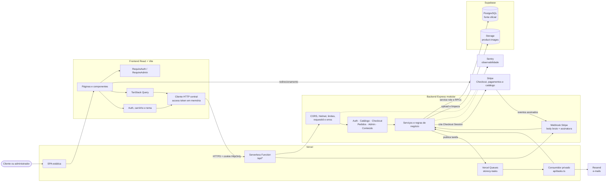
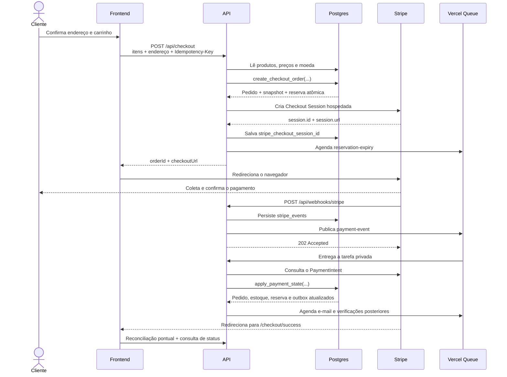
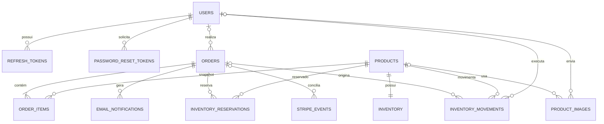

# Arquitetura do Storecy

Estado do código em **29/09/2026**. Este documento descreve somente a arquitetura presente no repositório; ações ainda necessárias estão identificadas como pendentes.

## Legenda de status

- [x] Implementado no código e versionado no repositório.
- [ ] Não implementado, não aplicado no ambiente remoto ou ainda não validado de ponta a ponta.

## 1. Visão geral

### Estado dos componentes

- [x] SPA em React 19, TypeScript e Vite, publicada como conteúdo estático na Vercel.
- [x] Backend Express 5 modular, exposto por uma Serverless Function da Vercel em `/api/*`.
- [x] PostgreSQL do Supabase como fonte oficial de catálogo, estoque, pedidos, sessões e eventos.
- [x] Supabase Storage para imagens públicas de produtos, normalizadas em WebP pelo backend.
- [x] Stripe Checkout Sessions em página hospedada para cartão e, quando habilitado na conta, Pix.
- [x] Webhook Stripe assinado, com persistência do evento antes do processamento assíncrono.
- [x] Vercel Queues para tarefas duráveis, adiadas, idempotentes e com retry; não há cron de aplicação.
- [x] Resend para recuperação de senha e confirmação de pagamento.
- [x] Sentry no backend e no frontend, além de logs JSON com `requestId` no backend.
- [ ] Infraestrutura externa e fluxo completo validados no ambiente de produção após a aplicação das migrations e variáveis descritas em `PLANO_ARQUITETURA_PRODUCAO.md`.



### Limites de responsabilidade

- [x] O navegador acessa dados de negócio exclusivamente pela API; não usa o cliente Supabase nem possui credencial de banco.
- [x] O backend é a fronteira de confiança para autenticação, preço, disponibilidade, autorização administrativa e transições de estado.
- [x] O Postgres executa, por RPCs transacionais, as mudanças críticas de pedido e estoque.
- [x] O Stripe decide o resultado financeiro; a aplicação o incorpora por webhook ou reconciliação pontual.
- [x] A fila executa efeitos posteriores e tarefas adiadas sem varreduras periódicas globais.

## 2. Frontend

### Funcionalidades implementadas

- [x] Catálogo, detalhe de produto, carrinho persistido localmente e tema.
- [x] Cadastro, login, logout, restauração da sessão e recuperação de senha.
- [x] Access token mantido somente em memória e refresh token em cookie `HttpOnly` enviado com `credentials: include`.
- [x] Cliente HTTP único em `lib/api/client.ts`, com uma tentativa coordenada de refresh após `401`.
- [x] Rotas protegidas para checkout, pedidos do cliente e administração.
- [x] Formulário de endereço com criação de chave de idempotência por carrinho.
- [x] Redirecionamento para a URL da Checkout Session retornada pelo backend.
- [x] Página de sucesso que solicita reconciliação pontual e consulta o status a cada 2,5 segundos, parando em estado terminal ou após 20 respostas/tentativas.
- [x] Área administrativa para catálogo, imagens, conteúdo da introdução, pedidos, notas e fulfillment.
- [x] TanStack Query como camada de cache e estado de requisições.
- [x] Captura de erros pelo Sentry quando `VITE_SENTRY_DSN` está configurado.

### O que não existe no frontend

- [x] Não há Payment Element, `Elements`, Stripe.js ou `client_secret` no código executável.
- [x] Não há confirmação de pagamento no navegador; o frontend apenas redireciona para o checkout hospedado.
- [x] Não há preço, total ou estoque enviados como fonte confiável ao backend.
- [x] Não há acesso direto do browser ao Supabase.

## 3. Backend e API

### Superfície HTTP atual

| Grupo | Rotas | Status |
|---|---|---|
| Saúde | `GET /api/health` | [x] |
| Autenticação | `POST /api/auth/login`, `register`, `refresh`, `logout`, `password-reset/request`, `password-reset/confirm`; `GET /api/auth/me` | [x] |
| Catálogo público | `GET /api/products`, `GET /api/products/:id` | [x] |
| Checkout | `POST /api/checkout` | [x] |
| Pedidos do cliente | `GET /api/orders`, `GET /api/orders/:id/status`, `POST /api/orders/:id/payment-reconciliation` | [x] |
| Conteúdo público | `GET /api/parameters/introduction-header` | [x] |
| Webhook | `POST /api/webhooks/stripe` | [x] |
| Operação administrativa | `GET /api/admin/health`, `GET /api/admin/metrics` | [x] |
| Catálogo administrativo | CRUD lógico em `/api/admin/products` e upload em `/api/admin/uploads/product-images` | [x] |
| Pedidos administrativos | listagem, notas e fulfillment em `/api/admin/orders` | [x] |
| Estoque administrativo | devolução manual em `/api/admin/inventory/:productId/return` | [x] |
| Conteúdo administrativo | leitura e atualização de `/api/admin/parameters/introduction-header` | [x] |

### Segurança de transporte e aplicação

- [x] CORS por allowlist, com credenciais e tratamento explícito de preflight.
- [x] Helmet, remoção de `x-powered-by`, limite JSON de 256 KiB e timeout de 15 segundos.
- [x] Rate limit geral, mais limites específicos para autenticação e checkout.
- [x] Erros com formato estável (`code`, `message`, `requestId` e, quando aplicável, `fieldErrors`).
- [x] Logs estruturados e redação de chaves sensíveis conhecidas.
- [x] Senhas com bcrypt, JWT de curta duração, rotação de refresh token por família e detecção de replay.
- [x] Cookie de refresh `HttpOnly`, `SameSite=Lax`, limitado a `/api/auth` e `Secure` em produção.
- [x] Autorização administrativa revalidada no banco por `is_admin`.
- [x] Validação estrita de checkout, endereço, paginação, produtos e origens de imagem.

## 4. Checkout, pagamento e estoque

### Fluxo principal



### Garantias implementadas

- [x] O backend recalcula o total com preço e moeda do Postgres.
- [x] `Idempotency-Key` é único por usuário e reaproveita um checkout compatível.
- [x] `create_checkout_order` usa lock, valida saldo, cria snapshots e reserva estoque na mesma transação.
- [x] A reserva dura 15 minutos; a Checkout Session tem expiração de segurança de 30 minutos e é encerrada pela tarefa de reserva quando necessário.
- [x] Falha ao criar, associar ou agendar a sessão executa compensação: expira a sessão quando possível e libera a reserva.
- [x] Eventos Stripe são deduplicados por `event_id` e processados de forma assíncrona.
- [x] Estados financeiros terminais não são rebaixados por eventos atrasados.
- [x] Pagamento aprovado converte reserva em venda, reduz `on_hand` e cria a notificação de e-mail na mesma transação.
- [x] Falha, cancelamento ou expiração libera a reserva.
- [x] Reembolso não devolve estoque automaticamente; a devolução física exige movimento administrativo explícito.
- [x] O histórico de estoque é preservado em `inventory_movements` com chave idempotente.
- [x] Cartão está sempre disponível; Pix só é anunciado quando disponível na configuração de pagamento padrão da conta Stripe.
- [x] Boleto não faz parte dos meios de pagamento atuais.

## 5. Processamento assíncrono sem cron

Todas as tarefas usam o tópico `storecy-tasks`. Tarefas com prazo superior ao limite de atraso da fila avançam em etapas até `notBefore`; em desenvolvimento, existe um executor local com retry.

| Tarefa | Gatilho | Responsabilidade | Status |
|---|---|---|---|
| `payment-event` | Webhook ou reconciliação do pedido | Consultar o Stripe e aplicar o estado financeiro | [x] |
| `email-delivery` | Pagamento aprovado | Entregar a outbox `order_paid` via Resend | [x] |
| `reservation-expiry` | Criação do checkout ou sessão expirada | Encerrar sessão/intenção e liberar reserva vencida | [x] |
| `product-image-cleanup` | Upload ou remoção de vínculo | Apagar imagem órfã após um dia | [x] |
| `order-fulfillment-check` | Pagamento aprovado | Alertar se o pedido continuar `paid` após 30 minutos | [x] |
| `order-pii-redaction` | Pagamento terminal processado ou entrega concluída | Anonimizar PII após `PII_RETENTION_DAYS` | [x] |
| `refresh-token-cleanup` | Emissão ou revogação | Excluir credencial após o prazo de retenção | [x] |
| `password-reset-token-cleanup` | Solicitação de reset | Excluir token expirado após a retenção | [x] |

- [x] Publicação com chave de idempotência derivada do payload.
- [x] Retry exponencial limitado e alerta no Sentry ao esgotar tentativas relevantes.
- [x] Script `tasks:backfill` para publicar tarefas de registros criados antes da migração para filas.
- [x] Não existe rota HTTP pública para disparar manutenção em lote.
- [x] Não existe configuração de cron no projeto.
- [ ] O caminho compensatório de falha durante a criação da Checkout Session ainda deve agendar a anonimização do pedido cancelado sem depender de backfill.

## 6. Persistência



### Grupos de dados

| Grupo | Tabelas | Responsabilidade | Status |
|---|---|---|---|
| Identidade | `users`, `refresh_tokens`, `password_reset_tokens` | Conta, sessão, revogação e recuperação | [x] |
| Catálogo | `products`, `product_images`, `parameters` | Produto oficial, mídia e conteúdo configurável | [x] |
| Pedidos | `orders`, `order_items`, `email_notifications` | Snapshot, pagamento, fulfillment e outbox | [x] |
| Estoque | `inventory`, `inventory_reservations`, `inventory_movements` | Saldo físico, reserva e ledger | [x] |
| Pagamentos | `stripe_events` e identificadores Stripe em `orders` | Auditoria, deduplicação e conciliação | [x] |

### Funções transacionais

- [x] `create_checkout_order`: cria pedido, itens, reservas e movimentos de reserva.
- [x] `release_order_reservation`: libera saldo reservado e encerra o pedido quando aplicável.
- [x] `apply_payment_state`: aplica transições financeiras e seus efeitos de estoque/outbox.
- [x] `admin_adjust_inventory`: ajusta saldo sem violar reservas.
- [x] `manual_return_inventory`: devolve fisicamente itens com auditoria.
- [x] `update_order_fulfillment`: impõe `paid -> packing -> shipped -> delivered`.
- [x] `redact_order_pii`: anonimiza pedidos terminais após a retenção.

### Modelo de acesso

- [x] Papéis `anon` e `authenticated` não têm acesso às tabelas privadas nem às RPCs críticas.
- [x] O backend usa `SUPABASE_SECRET_KEY`, que deve representar a credencial secreta/service role.
- [x] RLS fica desabilitado nas tabelas privadas porque elas não são uma API para o navegador; o isolamento é feito pela API e pela revogação de privilégios públicos.
- [x] O bucket `product-images` permite leitura pública; escrita e remoção passam pelo backend.
- [x] `transactions`, quando presente em banco legado, é renomeada para `transactions_legacy` e não participa do fluxo atual.
- [x] A migration `20260929_checkout_sessions.sql` adiciona o identificador único da Checkout Session a bancos existentes.
- [ ] A aplicação das migrations no banco remoto deve ser confirmada por ambiente.

## 7. Organização do repositório

```text
ecomerceReact2/
├── .github/                         # CI e Dependabot
├── backend/
│   ├── api/                         # Entradas Vercel: HTTP e consumidor da fila
│   ├── database/                    # Schema autoritativo e migrations incrementais
│   ├── scripts/                     # Importação, backfill e validação de deploy
│   ├── server/                      # Entrada HTTP local
│   ├── src/
│   │   ├── background/              # Contratos, publicação e consumo de tarefas
│   │   ├── config/                  # Env, CORS, segurança e Sentry
│   │   ├── db/                      # Cliente Supabase do servidor
│   │   ├── modules/                 # Auth, catálogo, checkout, pedidos etc.
│   │   ├── payments/                # Cliente e configuração Stripe
│   │   └── shared/                  # Erros, HTTP e logs
│   └── tests/                       # Testes unitários e de contrato
└── frontend_ecomerce/
    ├── components/                  # UI compartilhada por domínio
    ├── contexts/                    # Auth, carrinho e tema
    ├── lib/                         # Cliente HTTP, tema e formatação
    ├── src/
    │   ├── app/                     # Guards de rota
    │   ├── features/                # APIs e hooks por domínio
    │   └── pages/                   # Telas e rotas
    └── types/                       # Contratos compartilhados do frontend
```

### Regras de dependência

- [x] `api/index.ts` e `server/local.ts` carregam a mesma aplicação em `src/app.ts`.
- [x] Rotas fazem parsing/autorização e delegam regras a serviços de domínio.
- [x] Serviços podem depender de `db`, `payments`, `background` e `shared`; esses blocos não dependem das telas.
- [x] No frontend, páginas compõem hooks e componentes; todo HTTP passa por `lib/api/client.ts`.
- [x] Funções repetidas de estado financeiro, fila, API, formatação e UI foram centralizadas em módulos reutilizáveis.

## 8. Qualidade e observabilidade

- [x] Backend com compilação TypeScript, testes Vitest e validação do contrato de deploy Vercel.
- [x] Frontend com ESLint, testes Vitest, typecheck e build Vite.
- [x] CI executa instalação reprodutível, auditoria de dependências e `npm run check` nos dois projetos.
- [x] Dependabot agrupa atualizações semanais separadas para backend e frontend.
- [x] Métricas administrativas para eventos Stripe falhos, estoque negativo, fulfillment parado, e-mails falhos e divergência de catálogo.
- [x] Health check administrativo valida banco e Stripe.
- [ ] Testes de integração com banco real isolado, testes E2E no navegador e testes de concorrência ainda precisam ser adicionados.
- [ ] Alertas, dashboards e procedimentos de recuperação precisam ser validados no ambiente de produção.
