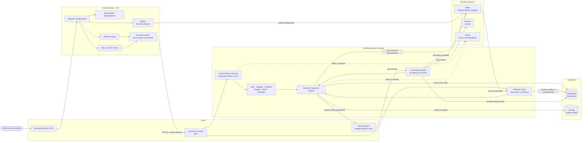
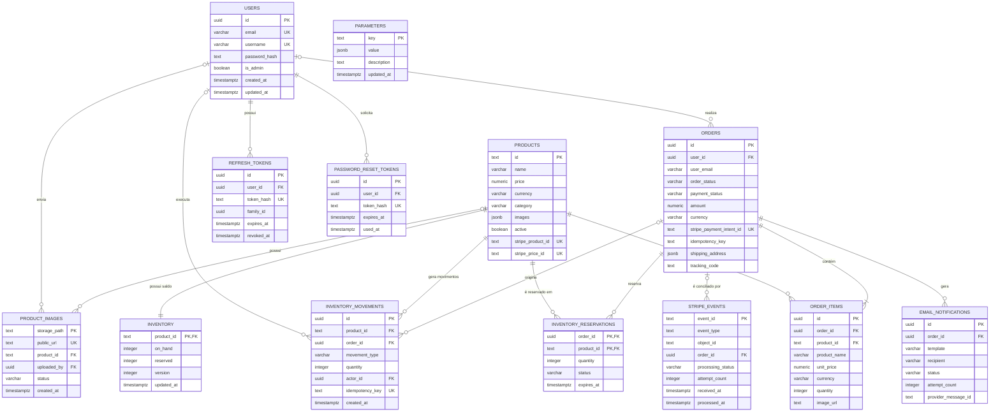
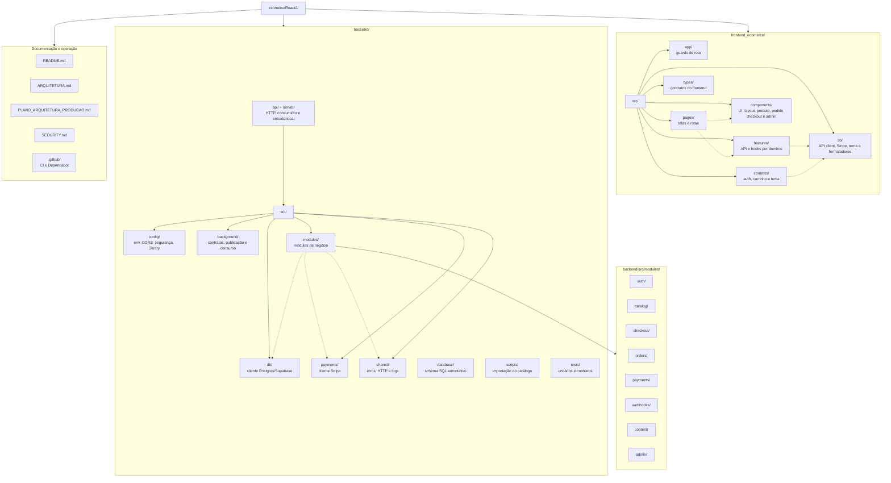

# Arquitetura do Storecy

Este documento representa a arquitetura implementada no repositório. Os diagramas usam [Mermaid](https://mermaid.js.org/) e podem ser visualizados diretamente no GitHub, GitLab e em editores Markdown com suporte a Mermaid.

## 1. Arquitetura do sistema

### Fluxos principais

1. O frontend nunca envia preço confiável: envia apenas produto e quantidade; o backend lê preço, moeda e estoque no Postgres.
2. O checkout cria o pedido e reserva o estoque atomicamente antes de criar o `PaymentIntent` no Stripe.
3. O webhook valida e persiste o evento antes de publicar uma tarefa. O consumidor atualiza pagamento, pedido, reserva, ledger e outbox de e-mail de forma idempotente.
4. A página de sucesso consulta o estado real e pode solicitar uma reconciliação pontual e autenticada do próprio pedido.
5. Checkout, upload e encerramento de pedido publicam tarefas adiadas para expiração de reserva, limpeza de imagem, retenção de credenciais e anonimização de PII.

## 2. Arquitetura do banco de dados

`STRIPE_EVENTS.object_id` referencia logicamente objetos Stripe e `order_id` mantém a associação auditável com o pedido. `PARAMETERS` é independente. As alterações críticas de pedido e estoque são feitas pelas funções transacionais do arquivo `backend/database/create-database.sql`.

### Grupos de responsabilidade do banco

| Grupo | Tabelas | Responsabilidade |
|---|---|---|
| Identidade | `users`, `refresh_tokens`, `password_reset_tokens` | Autenticação, renovação, revogação e recuperação de senha |
| Catálogo | `products`, `product_images`, `parameters` | Produtos oficiais, imagens e conteúdo configurável |
| Pedidos | `orders`, `order_items`, `email_notifications` | Snapshot da compra, fulfillment e outbox de e-mail |
| Estoque | `inventory`, `inventory_reservations`, `inventory_movements` | Saldo, reservas temporárias e ledger auditável |
| Pagamentos | `stripe_events` e campos Stripe em `orders` | Auditoria, idempotência e estado de pagamento |

## 3. Arquitetura de pastas e grupos de pastas

### Regra de dependência

- As entradas do backend carregam `src/app.ts`; as rotas delegam regras aos serviços dos módulos.
- Os módulos podem usar `db`, `payments` e `shared`; esses blocos não dependem das rotas.
- As páginas do frontend compõem componentes e hooks de domínio; o acesso HTTP passa pelo cliente central em `lib/api/client.ts`.
- Componentes compartilhados não devem importar páginas. Tipos e formatadores ficam fora das telas para evitar duplicação.

