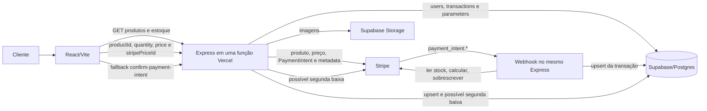
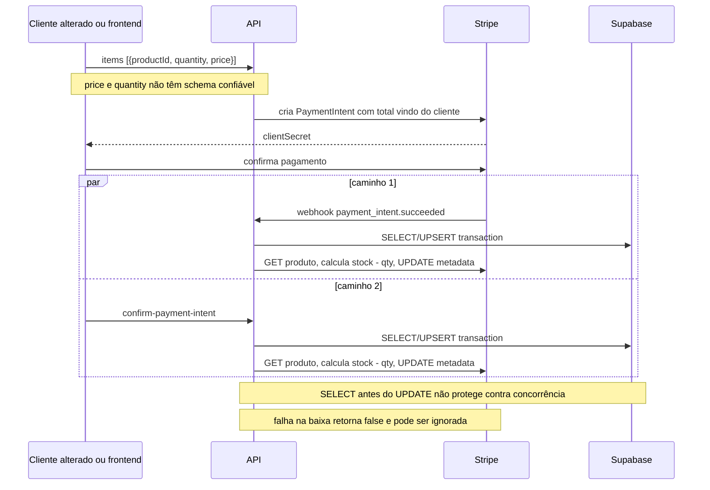
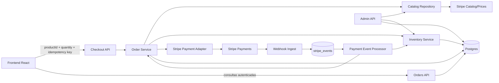
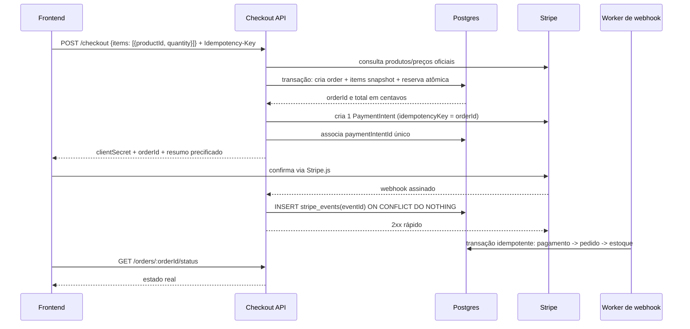

# Plano de arquitetura e preparação para produção

> Escopo analisado: `backend/` e `frontend_ecomerce/`  
> Data da análise: 22/09/2026  
> Objetivo: corrigir riscos de pagamento e estoque, reduzir duplicação e complexidade, remover legado com segurança e tornar as decisões arquiteturais explícitas.

## 1. Resumo executivo

O projeto compila e o frontend passa no lint, mas **ainda não deve ir para produção**. Há três bloqueadores críticos:

1. **O navegador define o valor cobrado.** O backend usa `item.price` recebido do frontend para montar o `PaymentIntent` (`backend/server/index.ts:325-350`; `frontend_ecomerce/src/pages/Checkout.tsx:36-55`). Um cliente alterado pode pagar R$ 0,01 por um produto real.
2. **O estoque não é transacional nem idempotente.** Ele é lido e depois sobrescrito no metadata do Stripe (`backend/lib/services/stock.ts:4-28`). Compras simultâneas podem vender acima do estoque. Webhook e página de sucesso também podem executar a baixa para o mesmo pagamento (`backend/server/index.ts:144-150` e `361-384`).
3. **O banco está exposto além do necessário.** O SQL concede `SELECT`, `INSERT` e `UPDATE` a `anon`/`authenticated`; a política de `users` usa `USING (true)` e permite ler todas as linhas, inclusive `password_hash` (`frontend_ecomerce/READ/database/create-database.sql:39-58`). `transactions` e `parameters` recebem grants públicos sem habilitar RLS (`:133` e `:160`).

Recomendação geral: manter um **monólito modular**, usar **Postgres como autoridade de pedidos e estoque**, usar o **Stripe somente como autoridade do pagamento** e, no curto prazo, como catálogo/preço até uma decisão explícita. O navegador deve enviar intenção (`productId` e `quantity`), nunca fatos financeiros.

### Ordem obrigatória

| Prioridade | Resultado esperado | Pode publicar antes? |
|---|---|---|
| P0 | Preço calculado no servidor, banco fechado, estoque atômico, idempotência e fluxo de sucesso correto | Não |
| P1 | Separação em módulos, contratos únicos, modelo de pedidos, paginação e remoção do legado confirmado | Somente após P0 |
| P2 | Observabilidade, testes completos, CI/CD, acessibilidade e otimizações | Publicação controlada pode ocorrer se os controles mínimos de P0/P1 estiverem prontos |

## 2. O que foi verificado

- Todo o código-fonte e configuração dos dois diretórios, exceto dependências geradas em `node_modules`.
- Fluxos de catálogo, carrinho, autenticação, checkout, webhook, estoque, pedidos, administração, imagens e parâmetros da home.
- SQL atual de criação do Supabase.
- Referências internas para localizar rotas, funções e tipos sem uso.
- `backend`: `npm run build` passou (`tsc --noEmit`).
- `frontend_ecomerce`: `npm run lint` passou.
- `frontend_ecomerce`: build de produção passou; bundle principal observado com cerca de 361 kB bruto/105 kB gzip.
- Auditoria das dependências de produção em 22/09/2026:
  - backend: `qs@6.15.3`, transitivo de Express/Stripe, com 1 alerta moderado (DoS/limite de arrays);
  - frontend: `react-router@7.18.1`/`react-router-dom@7.18.1` com 2 alertas altos ligados a bypass de CSRF em RSC Mode. O projeto não aparenta usar RSC Mode, o que reduz a aplicabilidade direta, mas a dependência deve ser corrigida mesmo assim.
- Não foram encontrados testes automatizados, pipeline de CI nem migrations versionadas.

Esta é uma análise estática e de build. Não foram executados pagamentos reais, concorrência contra o banco hospedado, replay de webhooks nem teste de carga.

## 3. Estrutura atual e responsabilidades observadas

```text
e/
├── backend/
│   ├── api/index.ts                 # adaptador da função Vercel
│   ├── server/index.ts              # 893 linhas: rotas + regras + Stripe + banco + formatação
│   ├── server/local.ts              # inicialização local
│   ├── lib/auth/                    # JWT próprio e leitura de Bearer token
│   ├── lib/config/                  # env e CORS
│   ├── lib/services/stock.ts        # estoque no metadata do Stripe
│   ├── lib/services/transactions.ts # sincronização Stripe -> transactions
│   ├── lib/stripe/                  # cliente Stripe
│   ├── lib/supabase/                # clientes anon e service-role
│   └── public/index.html            # página estática “Backend OK”
└── frontend_ecomerce/
    ├── src/App.tsx                  # providers e todas as rotas
    ├── src/pages/                   # páginas públicas, checkout e duas telas admin muito grandes
    ├── components/                  # UI, catálogo, pedidos, checkout e admin
    ├── contexts/                    # autenticação, carrinho e tema
    ├── lib/api/client.ts            # wrapper mínimo de fetch
    ├── lib/data/products.ts         # catálogo mock não referenciado
    ├── lib/hooks/useStock.ts        # segunda chamada de estoque
    ├── lib/stripe/stripe.ts         # Stripe.js
    ├── types/                       # tipos ativos misturados com contratos antigos
    └── READ/                        # SQL único e documentação desatualizada
```

### Problema estrutural central

`backend/server/index.ts` concentra transporte HTTP, validação, autenticação, autorização, regras de catálogo, pagamento, estoque, persistência e transformação de respostas. No frontend, `Admin.tsx` tem 996 linhas e `Transactions.tsx` tem 1.198 linhas. A separação atual é por arquivo técnico em alguns pontos, mas as regras de cada funcionalidade continuam espalhadas. Isso facilita divergência: o status do pedido, por exemplo, é traduzido de maneiras diferentes em `Transactions.tsx` e `OrderStatusBadge.tsx`.

## 4. Desenho do fluxo atual



### Fluxo atual de cobrança e onde ele quebra



### Exemplo da corrida de estoque

```text
Estoque inicial = 1

Compra A lê 1 ── calcula 0 ── grava 0
Compra B lê 1 ── calcula 0 ── grava 0

Resultado gravado = 0
Quantidade vendida = 2
Resultado correto deveria rejeitar uma compra.
```

## 5. Bloqueadores e riscos encontrados

| ID | Severidade | Problema | Evidência | Consequência |
|---|---|---|---|---|
| R01 | Crítica | Total confiado ao frontend | `server/index.ts:330-350`; `Checkout.tsx:39-54` | Fraude de preço e valores incorretos |
| R02 | Crítica | Estoque em read-modify-write no Stripe | `stock.ts:4-28` | Overselling e estoque perdido em concorrência |
| R03 | Crítica | Dois caminhos baixam estoque | `server/index.ts:144-150`, `361-384` | Baixa dupla do mesmo pagamento |
| R04 | Crítica | Banco acessível por papéis públicos | `create-database.sql:39-58`, `133`, `160` | Leitura de hashes, alteração de usuários/parâmetros/transações |
| R05 | Crítica se env faltar | JWT usa segredo conhecido como fallback | `lib/auth/jwt.ts:4` | Qualquer pessoa pode forjar usuário/admin |
| R06 | Alta | Quantidade, IDs e formato do carrinho não têm validação de runtime | `server/index.ts:330-337` | Quantidade negativa/fracionada, itens duplicados, payload excessivo |
| R07 | Alta | Criação de PaymentIntent sem idempotency key | `server/index.ts:339-352`; efeito em `Checkout.tsx:24-83` | Recarregar/repetir pode criar vários PaymentIntents |
| R08 | Alta | Upsert não é atômico e ignora erros do Supabase | `server/index.ts:834-883` | Webhook pode responder sucesso sem pedido persistido; corrida no unique |
| R09 | Alta | Eventos podem rebaixar status e nem todo caminho atualiza estoque | `transactions.ts:9-87`; webhook trata só três eventos | Estado fora de ordem, pagamento pago sem baixa ou cancelamento não refletido |
| R10 | Alta | Página mostra “Pagamento Confirmado” mesmo sem conferir resposta/status | `SuccessContent.tsx:26-54`, `79-88` | Falso positivo e carrinho apagado após falha/processing |
| R11 | Alta | Boleto não reserva estoque durante até 3 dias | `server/index.ts:343-344` | Várias pessoas podem pagar o mesmo último item |
| R12 | Alta | Rota legada de Checkout Session é pública e usa `stripePriceId` do cliente | `server/index.ts:396-416` | Fluxo paralelo incompleto, sem usuário e sem integração correta com estoque |
| R13 | Alta | JWT de admin vale 7 dias e autorização normalmente confia no claim antigo | `jwt.ts:13-14`; `middleware.ts:29-34` | Usuário removido de admin continua com acesso |
| R14 | Alta | `transactions` mistura pedido, pagamento e itens em JSON recebido via metadata | SQL `:64-80`; `server/index.ts:835-864` | Auditoria fraca, limite de metadata, histórico incompleto |
| R15 | Média | Produtos/estoque Stripe sem paginação explícita | `server/index.ts:290-317`, `419-425` | A listagem pode parar na primeira página |
| R16 | Média | Sincronização Stripe N+1 e serial em requisições de leitura | `transactions.ts:60-81`; `server/index.ts:702-710`, `746` | Latência, rate limit e timeout de serverless |
| R17 | Média | `/api/health` público revela configuração e origens; erros expõem mensagens internas | `server/index.ts:76-81`; `handler.ts:34-42` | Reconhecimento do ambiente e detalhes operacionais |
| R18 | Média | Upload base64, valida só MIME declarado e deixa órfãos | `server/index.ts:554-595`; `ProductImageManager.tsx:209-255` | Custo/memória, arquivo disfarçado e storage acumulado |
| R19 | Média | Carrinho persiste produto/preço inteiro no `localStorage` | `CartContext.tsx:24-39` | Dados adulteráveis e preço/estoque obsoletos |
| R20 | Média | Cadastro e login sem rate limit, senha mínima 6, sem recuperação/MFA/verificação | rotas auth em `server/index.ts:162-265` | Brute force e operação de identidade incompleta |
| R21 | Média | Produto físico aparente, mas não existe endereço, frete real ou fulfillment | tipos antigos existem, checkout não usa | Pedido pago sem dados suficientes para entrega |
| R22 | Média | Interface promete e-mail, mas não há serviço de e-mail | `SuccessContent.tsx:83-88` | Promessa falsa ao cliente |
| R23 | Média | Sem testes, CI, migrations versionadas ou rollback | estrutura do projeto | Regressões financeiras e deploy não reproduzível |
| R24 | Baixa/média | CORS é aplicado em dois lugares | `lib/vercel/handler.ts:17-23`; `server/index.ts:66-74` | Complexidade e respostas divergentes |
| R25 | Baixa/média | Tratamento de API, loading, erro e token repetido | `api/client.ts` e várias páginas admin | Mais código e comportamentos inconsistentes |
| R26 | Alta no audit | React Router instalado está em faixa com advisories | `react-router(-dom)@7.18.1`; [GHSA-qwww-vcr4-c8h2](https://github.com/advisories/GHSA-qwww-vcr4-c8h2) | Dependência vulnerável; aplicabilidade RSC parece limitada neste SPA, mas requer atualização |
| R27 | Média no audit | `qs@6.15.3` transitivo tem advisories de DoS | árvore de Express/Stripe; [GHSA-x5fp-wj9c-mxmx](https://github.com/advisories/GHSA-x5fp-wj9c-mxmx) e [GHSA-4mjr-xmp4-gh2g](https://github.com/advisories/GHSA-4mjr-xmp4-gh2g) | Payload malicioso pode consumir recursos; atualizar árvore e manter limites de body/query |
| R28 | Média | Config local do backend procura `.env.local` do frontend e usa nomes antigos de chaves Supabase | `lib/config/env.ts:3-7`; `lib/supabase/client.ts:8-35` | Fronteira de segredos confusa e migração futura mais difícil |

## 6. Decisões propostas — responda com os códigos escolhidos - Em qualquer divergência, essa seção prevalece. Essa seção (6) é a mais importante.

Cada alteração abaixo tem opções. Faça a opção marcada como **SELECIONADA**. A opção marcada como **Recomendada** é o padrão sugerido se não houver uma preferência de negócio diferente.

### Checklist de implementação no repositório (23/09/2026)

Os códigos sem `SELECIONADA` explícita abaixo adotam a alternativa recomendada/mais simples compatível com as demais escolhas. `[x]` significa implementado e verificado no repositório; não significa que SQL, segredos, webhooks ou serviços externos já foram aplicados no ambiente hospedado.

- [x] **D01-B** — Postgres é autoridade de catálogo/preço; checkout não aceita preço do cliente.
- [x] **D02-X** — validação manual somente nas fronteiras necessárias, com limites estritos de carrinho, auth, catálogo, endereço e uploads.
- [x] **D03-A** — estoque e disponibilidade existem apenas no Postgres e passam pelo serviço/RPC de inventário.
- [x] **D04-D** — boleto removido; Payment Element limitado a cartão e Pix, ambos protegidos por reserva de 15 minutos.
- [x] **D05-A** — webhook persiste evento idempotente; worker é o escritor do estado; página de sucesso apenas consulta.
- [x] **D06-A** — somente backend usa a secret key; SQL revoga `anon/authenticated` e não usa RLS nas tabelas privadas.
- [x] **D07-B** — auth própria com secrets obrigatórios, access token de 15 min, refresh rotativo/revogável em cookie, rate limit, reset de senha e papel admin reconsultado.
- [x] **D08-C** — sucesso mostra estado real por polling de `GET /orders/:id/status` e não reconcilia/escreve.
- [x] **D09-A** — Payment Element mantido; Checkout Session e rota paralela removidos.
- [x] **D10-B** — `orders` + `order_items`, pagamento 1:1 em `orders`; tabela antiga é renomeada para preservação, fora do runtime.
- [x] **D11-B** — Postgres é catálogo oficial; alterações administrativas versionam Price no Stripe; importador inicial disponível.
- [x] **D12-A** — backend reorganizado como monólito modular por auth, catálogo, checkout, pedidos, pagamentos, webhook, conteúdo, admin e jobs.
- [x] **D13-C** — DTOs manuais, sem pacote compartilhado, com teste de contrato do checkout.
- [x] **D14-A** — `apiClient` único com sessão/erro/timeout do servidor e TanStack Query para catálogo e pedidos.
- [x] **D15-A** — itens congelam produto, nome, preço, moeda, quantidade e imagem.
- [x] **D16-A** — webhook normal + job paginado/limitado de reconciliação de pendentes.
- [x] **D17-A** — `RequireAuth`/`RequireAdmin`; páginas não leem token do `localStorage`.
- [x] **D18-B** — upload multipart, magic bytes/decodificação via Sharp, resize WebP, ownership e limpeza de órfãos; URL externa exige allowlist/CSP.
- [x] **D19-A** — endereço congelado, frete grátis, estados de fulfillment, rastreio e anonimização configurável de PII.
- [x] **D20-C** — reembolso não repõe estoque; devolução manual gera ledger auditável.
- [x] **D21-A** — `OrderDetails`, `OrderProductList`, `OrderStatusBadge`, formatadores e `Dialog` acessível compartilhados por cliente/admin.
- [x] **D22-A** — mocks, serviços Stripe de estoque, rotas antigas, tipos especulativos, diretivas Vite inúteis e documentação duplicada removidos com build/testes.
- [x] **D23-A** — logs JSON correlacionados, métricas/alertas operacionais e Sentry sem envio padrão de PII.
- [ ] **D24-A (parcial)** — CI, lint, typecheck, build, unitários e contrato implementados; ainda faltam integração real Postgres/Stripe fake e E2E de navegador/concorrência antes do go-live.
- [x] **D25-C** — um único `create-database.sql` manual e reexecutável, conforme a escolha selecionada (mantém a limitação de não haver migrations incrementais).
- [x] **D26-A** — refresh em cookie `HttpOnly/Secure/SameSite`; access token curto somente em memória e proteção por origem/CORS.
- [x] **D27-A** — webhook só valida/persiste e responde 202; tabela funciona como fila durável e cron processa retry/dead-letter por tentativas.
- [x] **D28-C** — `NUMERIC/DECIMAL` no banco convertido para `number`, conforme selecionado (Stripe recebe centavos arredondados).
- [x] **D29-A** — `inventory_movements` imutável, motivos/atores e chaves idempotentes, atualizado na mesma função transacional.
- [x] **D30-A** — outbox idempotente e envio assíncrono por Resend após pagamento pago.
- [x] **D31-A** — cursores/limites no backend, filtros server-side e paginação completa no importador Stripe.
- [x] **D32-A** — erros públicos `{ code, message, requestId, fieldErrors? }`; causas internas ficam nos logs/Sentry.
- [x] **D33-A** — rate limits, Helmet, CSP, body/query limitados, timeout, CORS allowlist e `x-powered-by` desativado.
- [x] **D34-A** — Router/`qs` corrigidos, audit de produção zerado, CI bloqueia severidade alta e Dependabot semanal.
- [x] **D35-A** — envs separadas, prefixo `VITE_`, exemplos sem valores e falha de boot para configuração/segredos obrigatórios.

### D01 — Quem determina o preço cobrado? (P0)

**Motivo:** corrigir R01 imediatamente.

- **D01-B:** **SELECIONADA** Postgres é o catálogo/preço oficial; backend lê o preço do banco e mantém `stripe_price_id` sincronizado. Melhor para regras comerciais complexas, mas exige migração do catálogo.
- **D01-A** frontend envia somente `{ productId, quantity }`; backend busca o produto ativo e seu `default_price` no Stripe, valida moeda e `unit_amount`, soma em centavos e cria o PaymentIntent.
- **D01-C — Não aceitável em produção:** manter `price` vindo do cliente com comparação posterior. Ainda cria janelas de fraude e divergência.

Critérios de aceite: `price` e `stripePriceId` deixam o request; total usa inteiros; produto inativo, preço recorrente, moeda inesperada, `unit_amount = null` ou ID inexistente são rejeitados; teste prova que `price: 0.01` não altera o valor.

### D02 — Como validar requests e responses? (P0)

**Motivo:** TypeScript não valida JSON recebido em runtime; hoje há muitos `any`.
  
- X **SELECIONADA** Faça o mais simples. Faça algo somente se tiver necessidade.  

- **D02-A** schemas compartilhados com Zod/Valibot em um pacote `contracts`; o mesmo schema gera tipos para frontend/backend.
- **D02-B:** OpenAPI como fonte e cliente/tipos gerados. Mais formal e bom para outros consumidores.
- **D02-C:** validação manual por rota. Menos dependência, porém repete código e é mais fácil esquecer casos.

Regras mínimas do carrinho: 1–50 itens; `productId` com formato permitido; `quantity` inteiro entre 1 e um limite de negócio; IDs duplicados consolidados/rejeitados; body com limite menor; campos extras descartados ou rejeitados.

### D03 — Onde o estoque deve ser salvo? (P0)

**Motivo:** metadata do Stripe não oferece a transação de inventário necessária.

- **D03-A:** **SELECIONADA** Postgres é a única fonte do estoque. **Arquitetura mais simples.**
- **D03-B — Catálogo no Stripe:** Postgres é a autoridade; Stripe recebe uma cópia assíncrona apenas para visualização/admin. Divergência nunca muda a decisão de venda.
- **D03-C — Não recomendada:** Stripe metadata continua como autoridade. Não resolve concorrência nem histórico.

Resposta objetiva: **quem diminui o estoque é somente o `InventoryService`, dentro de uma transação/função atômica no Postgres.** Nem frontend, nem página de sucesso, nem controller e nem Stripe metadata fazem a baixa diretamente.

### D04 — Quando comprometer o estoque? (P0)

**Motivo:** cartão pode confirmar rápido; boleto pode levar dias.

- **D04-A — Recomendada:** reservar atomicamente ao iniciar checkout; converter reserva em venda no `payment_intent.succeeded`; liberar em falha, cancelamento ou expiração. Para boleto, estender reserva quando entrar em `processing`, de acordo com a expiração do voucher.
- **D04-B:** baixar somente no sucesso. É mais simples, mas aceita risco de pagamento aprovado sem estoque.
- **D04-C:** reservar apenas para boleto e baixar cartão no sucesso. Menos reservas, mas duas regras aumentam complexidade.
- **D04-D:** **SELECIONADA** remover boleto e manter só cartão até existir reserva. É o menor caminho seguro para uma primeira publicação. Somente cartão e pix.

Pergunta de negócio: por quanto tempo um checkout de cartão deve reservar (ex.: 15 min)? O boleto realmente deve bloquear a unidade por até 3 dias?

### D05 — Qual caminho pode confirmar pedido e movimentar estoque? (P0)

**Motivo:** eventos duplicados/fora de ordem.

- **D05-A** webhook é o escritor principal; página de sucesso apenas consulta `GET /orders/:id/status`. Um job de reconciliação recupera webhooks perdidos.
- **D05-B:** webhook e endpoint de reconciliação chamam a mesma operação transacional idempotente. O endpoint nunca contém lógica própria.
- **D05-C — Não recomendada:** manter dois blocos independentes com `previousStatus` lido antes da gravação.

Obrigatório em A ou B: tabela `stripe_events` com `event_id` único; movimento de estoque com chave única por `order_id + product_id + movement_type`; transição de estado monotônica; assinatura do webhook sobre body bruto; processamento repetível.

O Stripe documenta que webhooks podem ser duplicados e entregues fora de ordem; recomenda registrar `event.id` e não depender da ordem ([Stripe Webhooks](https://docs.stripe.com/webhooks)).

### D06 — Como proteger o Supabase? (P0)

**Motivo:** corrigir R04 antes de qualquer exposição pública.

- **D06-A — Recomendada para o desenho atual:** toda leitura/escrita de dados privados passa pelo backend; usar chave secreta somente no servidor; revogar grants de `anon/authenticated` em tabelas privadas; Não usar RLS. Vamos usar auth própria JWT. **SELECIONADA**
- **D06-B:** migrar autenticação para Supabase Auth e permitir alguns acessos diretos do frontend com RLS por `auth.uid()`. Reduz código de auth, mas cria dois caminhos de dados.
- **D06-C:** manter backend com publishable/anon key e escrever policies corretas para o JWT do Supabase. Só funciona bem se a autenticação também for Supabase Auth.

### D07 — Qual estratégia de autenticação? (P0/P1)

**Motivo:** remover fallback de segredo, claim admin obsoleto e recursos de identidade incompletos.

- **D07-A —** Supabase Auth; `profiles/roles` no banco; token validado pelo backend; recuperação de senha, verificação de e-mail e rotação ficam no provedor.
- **D07-B:** **SELECIONADA** manter auth própria, mas exigir `JWT_SECRET` forte no boot, access token curto, refresh token rotativo/revogável, rate limit, reset de senha, e consultar papel atual do usuário para ações admin.
- **D07-C:** provedor externo (Auth0/Clerk/Cognito etc.). Mais recursos, custo e dependência.

Independentemente da opção: remover `|| 'your-secret-key'`, definir issuer/audience/algoritmo, não guardar autorização administrativa por 7 dias sem revalidação e retornar 401 para ausência/invalidade, 403 apenas para falta de permissão.

### D08 — O que a página de sucesso deve fazer? (P0)

**Motivo:** Faça algo simples que funcione bem. Hoje ela exibe sucesso e apaga o carrinho mesmo se o endpoint falhar ou o boleto estiver pendente.

- **D08-A** receber `orderId`, consultar o backend e renderizar `pago`, `aguardando boleto`, `processando`, `falhou` ou `cancelado`; limpar o carrinho apenas quando o pedido correspondente foi criado com segurança.
- **D08-B:** manter reconciliação ativa nessa página, mas a chamada deve retornar e exibir o status real; toda mutação usa o mesmo serviço idempotente de D05-B.
- **D08-C:** esperar somente webhook e mostrar “processando” até polling confirmar. Simples e seguro, com possível pequena espera.

### D09 — Payment Element ou Checkout Session? (P0)

**Motivo:** existem dois checkouts, mas só o Payment Element é chamado pelo frontend.

- **D09-A** manter Payment Element e remover `/api/create-checkout-session` após teste de ausência de consumidores.
- **D09-B:** migrar integralmente para Stripe Checkout hospedado e remover Payment Element/`CheckoutForm`.
- **D09-C — Não recomendada:** manter ambos sem caso de negócio, duplicando regras de preço, retorno e webhook.

### D10 — Como representar pedido, pagamento e itens? (P1)

**Motivo:** `transactions` hoje representa três conceitos e guarda itens em JSON.

- **D10-A** separar `orders`, `order_items`, `payments` e `stripe_events`; estoque/reservas em tabelas próprias.
- **D10-B:** **SELECIONADA** manter `transactions`, mas renomear para `orders` e normalizar `order_items`; pagamento fica em colunas 1:1. Menos tabelas, suficiente se nunca houver múltiplas tentativas/reembolsos.
- **D10-C:** continuar com JSONB. Menos migration agora, mas pior para auditoria, consulta, constraints e evolução.

### D11 — Quem é autoridade do catálogo e do preço depois do hotfix? (P1)

- **D11-A** Stripe continua autoridade de produto/preço; Postgres guarda `stripe_product_id`, estoque, pedidos e snapshots. A API faz cache curto e pagina todas as respostas.
- **D11-B:** **SELECIONADA** Postgres vira autoridade do catálogo/preço; alterações administrativas criam versões de Price no Stripe. Melhor para categorias, SEO, promoções e busca.
- **D11-C:** dupla autoridade bidirecional. Evitar: conflitos e reconciliação aumentam muito a complexidade.

Deve eliminar problemas da confiança no cliente.

### D12 — Como reorganizar o backend? (P1) Não sei

- **D12-A — Recomendada:** monólito modular por funcionalidade, com no máximo `route/controller`, `service`, `repository` e `schema` quando necessários.
- **D12-B:** arquitetura hexagonal/clean completa. Útil se houver muitas integrações/equipe grande, mas adiciona abstrações.
- **D12-C:** apenas dividir `server/index.ts` em arquivos de rota. É um primeiro passo, mas regras continuam acopladas ao HTTP.
- **D12-D:** microserviços. Não recomendado para este tamanho; piora deploy, observabilidade e consistência.

### D13 — Como compartilhar contratos e evitar tipos repetidos? (P1)

- **D13-A — Recomendada se os dois projetos puderem virar workspace:** `packages/contracts` com schemas e DTOs compartilhados; backend e frontend importam a mesma definição.
- **D13-B:** backend publica OpenAPI e frontend gera cliente/tipos.
- **D13-C:** **SELECIONADA** tipos manuais em ambos com testes de contrato. Menos configuração, mais risco de divergência.

Unificar: `Product`, `Order`, `OrderItem`, `PaymentStatus`, `IntroductionHeader`, respostas de erro, paginação e filtros.

### D14 — Como centralizar chamadas e estado remoto no frontend? (P1)

- **D14-A — Recomendada:** cliente HTTP tipado com token, timeout, parse de erro, correlation ID e hooks de feature usando TanStack Query/SWR para cache e invalidação.
- **D14-B:** manter hooks próprios, mas criar um serviço por feature e um único `apiClient` com os mesmos controles.
- **D14-C:** continuar usando `fetch` diretamente nas páginas. Não atende ao objetivo de reuso.

Isso elimina a chamada dupla `/api/products` + `/api/stock` em `ProductGrid`, a busca de todos os produtos na tela de detalhe e a leitura direta de `localStorage` em cada página admin.

### D15 — Que dados do produto ficam congelados no pedido? (P1)

- **D15-A — Recomendada:** `order_items` salva `product_id`, nome, preço unitário em centavos, moeda, quantidade e opcionalmente imagem/SKU no momento da compra.
- **D15-B:** salvar só IDs e consultar catálogo atual. Menos dados, mas pedidos antigos mudam de nome ou perdem informação quando o produto é arquivado.
- **D15-C:** snapshot JSON no pedido. Aceitável como etapa temporária, sem a mesma integridade relacional.

Com D15-A, `MyOrders` e `Transactions` deixam de chamar `/api/products` apenas para descobrir nomes.

### D16 — Como manter status de pagamento sincronizado? (P1)

- **D16-A — Recomendada:** webhook como fluxo normal + job agendado de reconciliação paginado para pedidos pendentes antigos.
- **D16-B:** somente webhook, com alerta e replay manual. Menos código, recuperação operacional pior.
- **D16-C:** sincronizar todos os pendentes dentro de cada GET. Remover; produz N+1 e timeout.

### D17 — Como proteger e reaproveitar rotas de usuário/admin no frontend? (P1)

- **D17-A — Recomendada:** componentes `RequireAuth` e `RequireAdmin`; `AuthContext` expõe uma sessão única; páginas não acessam `localStorage` diretamente.
- **D17-B:** loaders do React Router fazem a proteção e pré-carregam dados.
- **D17-C:** manter verificação repetida por página. Não atende ao objetivo de reuso.

Proteção do frontend é UX; autorização real continua obrigatoriamente no backend.

### D18 — Como fazer upload e ciclo de vida das imagens? (P1)

- **D18-A** backend autoriza uma URL assinada curta; browser envia direto ao Storage; backend valida arquivo final, registra ownership e remove órfãos por job.
- **D18-B:** **SELECIONADO** backend recebe `multipart/form-data`, valida magic bytes, redimensiona e envia ao Storage. Mais controle, mais custo serverless.
- **D18-C:** manter base64 em JSON, adicionando magic bytes, limites, quantidade máxima e limpeza. Funciona em baixo volume, mas é menos eficiente.

Aceitar URL externa. Se aceitar externa, adicionar allowlist/CSP e política de privacidade.

### D19 — Os produtos são físicos? (P0 de negócio)

- **D19-A** **SELECIONADO** coletar e congelar endereço; definir frete, prazo, estados `paid/packing/shipped/delivered`, rastreio e LGPD/retenção.
- **D19-B:** produtos digitais; remover tipos/endereço/frete e implementar entrega digital.
- **D19-C:** catálogo misto; `fulfillment_type` por item e regras separadas.

Hoje a UI afirma “Frete grátis” sem coletar endereço, e o tipo `ShippingAddress` antigo não participa do fluxo.

### D20 — Quando devolver estoque? (P1)

- **D20-A — Recomendada:** cancelamento antes do fulfillment e pagamento falho liberam reserva; reembolso não devolve automaticamente; admin escolhe “item retornou ao estoque”, gerando movimento auditável.
- **D20-B:** todo reembolso devolve estoque. Simples, mas errado para perda, avaria ou fraude.
- **D20-C:** **SELECIONADO** nunca devolver automaticamente; sempre operação manual. Seguro, mas aumenta trabalho.

Definir também tratamento de `payment_intent.payment_failed`, `payment_intent.canceled`, refunds e disputes.

### D21 — Como reduzir duplicação visual e de domínio? (P1)

- **D21-A — Recomendada:** **SELECIONADO** extrair `OrderDetails`, `OrderModal`, `StatusBadge`, `Money`, `DateTime`, `FormField`, `Dialog` e feedback; admin e cliente compõem os mesmos blocos.
- **D21-B:** compartilhar só formatadores e tipos, mantendo layouts separados.
- **D21-C:** manter duplicação. Não recomendado: status e formatação já divergiram.

### D22 — Como tratar o código legado? (P1)

- **D22-A — Recomendada:** **SELECIONADO** remover em PRs pequenos, cada um com busca de referências, build e testes.
- **D22-B:** mover por uma release para `legacy/` com data e dono, depois remover.
- **D22-C:** manter comentado/sem uso. Não recomendado: aumenta custo cognitivo.

A lista concreta está na seção 11.

### D23 — Qual nível de observabilidade? (P1/P2)

- **D23-A — Recomendada:** **SELECIONADO** logs JSON com `requestId`, `orderId`, `paymentIntentId`, `eventId`; métricas e alertas para webhook falho, estoque negativo, pedidos pagos não finalizados e divergência Stripe/DB; ferramenta gerenciada de erros.
- **D23-B:** somente logs estruturados da plataforma e alertas do Stripe/Supabase. Mínimo aceitável no começo.
- **D23-C:** `console.log/error` atual. Insuficiente para incidentes financeiros.

Nunca registrar segredo, client secret, senha, token ou payload completo com PII.

### D24 — Qual estratégia de testes e CI? (P0/P1)

- **D24-A — Recomendada:** **SELECIONADO** unitários de regras + integração Postgres/Stripe fake + contrato da API + E2E dos fluxos críticos; CI bloqueia merge por lint, typecheck, testes, build e migration check.
- **D24-B:** integração + E2E críticos primeiro; unitários depois. Bom caminho incremental.
- **D24-C:** somente testes manuais. Não aceitável para pagamento/estoque em produção.

Casos obrigatórios estão na seção 13.

### D25 — Como versionar banco e deploy? (P1)

- **D25-A** **No futuro quem sabe** Supabase CLI/migrations incrementais versionadas, ambientes dev/staging/prod, backup e plano de rollback/forward-fix.
- **D25-B:** ferramenta de migration independente (Prisma/Drizzle/Flyway etc.). Boa se ela também for adotada como camada de dados.
- **D25-C:** **SELECIONADO** continuar com um `create-database.sql` editado e executado manualmente. Não é reproduzível.

### D26 — Onde armazenar sessão no navegador? (P1)

- **D26-A** cookies `HttpOnly`, `Secure`, `SameSite`, sessão curta/renovável e proteção CSRF quando aplicável.
- **D26-B:** **Recomendada se fizer sentido com a auth própria JWT** tokens curtos do Supabase Auth com refresh/rotação administrados pelo SDK e CSP forte.
- **D26-C:** JWT de 7 dias no `localStorage`. Manter apenas temporariamente; XSS consegue roubá-lo e não há revogação.

### D27 — Webhook síncrono ou fila? (P1/P2)

- **D27-A — Recomendada para produção robusta:** verificar assinatura, persistir evento idempotentemente, responder 2xx rápido e processar em worker/fila com retry e dead-letter.
- **D27-B:** processar síncrono, mas com transação curta, timeout, idempotência e retry do Stripe. Aceitável em volume baixo.
- **D27-C:** fazer consultas Stripe e várias atualizações sequenciais antes da resposta, como hoje. Risco de timeout.

### D28 — Como representar dinheiro? (P0)

- **D28-A** inteiro em menor unidade (`amount_cents`/`unit_amount`) e moeda por registro; nunca `number` decimal como autoridade.
- **D28-B:** `NUMERIC` no banco e biblioteca decimal na aplicação.
- **D28-C:** **SELECIONADO** float/`DECIMAL` convertido para `number` como hoje. Evitar por arredondamento e contratos ambíguos.

### D29 — Como auditar mudanças de estoque? (P1)

- **D29-A — Recomendada:** **SELECIONADO** ledger `inventory_movements` imutável, com motivo, quantidade, pedido/admin, timestamp e chave idempotente; saldo materializado é atualizado na mesma transação.
- **D29-B:** guardar apenas saldo e uma tabela simples de audit log.
- **D29-C:** sobrescrever saldo sem histórico. Não recomendado para produção.

### D30 — A confirmação por e-mail será implementada? (P1 de produto)

- **D30-A:** **SELECIONADO** implementar envio assíncrono idempotente após pedido pago, com template e status de entrega.
- **D30-B:** remover da tela a promessa de e-mail.
- **D30-C:** enviar pelo Stripe habilitando recibos e ajustar o texto para o comportamento real.

### D31 — Como paginar e consultar dados? (P1)

- **D31-A — Recomendada:** **SELECIONADO** paginação cursor-based no backend; iterar paginação Stripe; filtros de transação no servidor; limites máximos.
- **D31-B:** paginação por offset no Postgres e automática no Stripe. Mais simples, pior em tabelas grandes/mutáveis.
- **D31-C:** carregar tudo e filtrar no browser. Remover antes de volume real.

### D32 — Qual contrato de erro usar? (P1)

- **D32-A — Recomendada:** `{ code, message, requestId, fieldErrors? }`, mensagens públicas estáveis e causa interna só nos logs.
- **D32-B:** RFC 9457 Problem Details.
- **D32-C:** strings livres e `error.message` de Stripe/Supabase. Evitar vazamento e inconsistência.

### D33 — Controles HTTP mínimos (P0/P1)

- **D33-A — Recomendada:** rate limit por rota/identidade, Helmet/headers equivalentes, CSP no frontend, limites de body, timeout, `app.disable('x-powered-by')`, allowlist CORS por ambiente e proteção contra brute force.
- **D33-B:** controles equivalentes no gateway/WAF da hospedagem, mantendo validações no app.
- **D33-C:** CORS como único controle. CORS não autentica chamadas server-to-server.

### D34 — Como manter dependências seguras e compatíveis? (P0/P2)

- **D34-A — Recomendada:** atualizar imediatamente React Router e a árvore que contém `qs` para versões corrigidas; revisar changelogs; executar build, contrato, E2E e smoke; habilitar Renovate/Dependabot semanal e `npm audit` no CI com política de exceção documentada e prazo.
- **D34-B:** atualização manual mensal com janela fixa e os mesmos testes.
- **D34-C:** executar `npm audit fix` sem revisão. Evitar em produção: alterações transitivas precisam de teste, e `--force` pode introduzir breaking changes.

Fixar e revisar deliberadamente a versão da API Stripe e a versão do webhook. Não alterar `apiVersion` apenas para “ficar mais nova”; atualizar SDK/API em PR próprio, com fixtures de eventos das versões antiga e nova.

### D35 — Como separar configuração e segredos? (P0/P1)

- **D35-A — Recomendada:** backend lê apenas seu ambiente e falha no boot com schema tipado; frontend expõe somente variáveis públicas prefixadas com `VITE_`; adicionar `.env.example` sem valores; remover fallback para o `.env.local` do frontend; migrar chaves Supabase legadas para publishable/secret conforme disponibilidade da conta.
- **D35-B:** manter nomes atuais por compatibilidade, mas remover leitura cruzada e documentar quais são públicas/secretas.
- **D35-C:** manter múltiplos fallbacks silenciosos. Evitar: um deploy pode iniciar com configuração errada e só falhar em uma rota crítica.

Não usar RLS.
A documentação atual do Supabase informa que as chaves legadas `anon`/`service_role` caminham para descontinuação e recomenda publishable/secret, sempre mantendo a secret apenas no backend ([Supabase API keys](https://supabase.com/docs/guides/getting-started/api-keys)).


## 7. Arquitetura alvo recomendada



### Regra de responsabilidade

| Componente | Responsável por | Não deve fazer |
|---|---|---|
| Frontend | Capturar intenção, exibir catálogo/status, manter estado visual | Definir preço final, confirmar pedido no banco, baixar estoque |
| Checkout service | Validar usuário/carrinho, obter preço oficial, criar pedido/reserva e um PaymentIntent | Confiar em total do cliente |
| Catalog repository | Produto ativo, preço/moeda oficiais e mapeamento Stripe | Controlar saldo de estoque |
| Inventory service | Reservar, vender, liberar e ajustar estoque atomicamente | Chamar Stripe para decidir disponibilidade |
| Order service | Estado do pedido, itens congelados, total e transições válidas | Receber JSON arbitrário de produtos como registro final |
| Stripe adapter | Criar/consultar PaymentIntent com idempotency key | Virar banco de pedidos/estoque |
| Webhook ingest | Validar assinatura, deduplicar `event.id`, persistir recebimento | Reimplementar regra de pedido em controllers |
| Payment processor | Aplicar evento à máquina de estados e chamar estoque/pedido | Depender da página de sucesso |
| Postgres | Autoridade de pedido, estoque, reserva, eventos e auditoria | Depender de metadata como storage principal |
| Stripe | Autoridade do estado financeiro | Ser autoridade de inventário |

## 8. Fluxo alvo do checkout



### Operação atômica mínima sem reserva

Se D04-B for escolhida temporariamente, a baixa ainda precisa ser uma única operação condicional, por exemplo conceitualmente:

```sql
UPDATE inventory
SET on_hand = on_hand - :quantity,
    updated_at = now()
WHERE product_id = :product_id
  AND on_hand >= :quantity
RETURNING on_hand;
```

Para vários itens, executar dentro de uma transação, bloquear/atualizar em ordem estável e fazer rollback de tudo se qualquer item falhar. O PostgreSQL documenta que `FOR UPDATE` impede outros writers sobre as linhas até o fim da transação ([row-level locks](https://www.postgresql.org/docs/current/explicit-locking.html#LOCKING-ROWS)). Não manter a transação aberta enquanto espera o usuário ou o Stripe.

## 9. Modelo de dados sugerido

```text
products
  id / stripe_product_id UNIQUE / active / optional catalog cache

inventory
  product_id PK / on_hand / reserved / version / updated_at
  CHECK on_hand >= 0, reserved >= 0, reserved <= on_hand

orders
  id / user_id / order_status / payment_status
  amount_total_cents / currency
  stripe_payment_intent_id UNIQUE NULLABLE
  idempotency_key UNIQUE / created_at / updated_at

order_items
  order_id / product_id / product_name_snapshot
  unit_amount_cents / currency / quantity
  UNIQUE(order_id, product_id)

inventory_reservations
  order_id / product_id / quantity / status / expires_at
  UNIQUE(order_id, product_id)

inventory_movements
  id / product_id / order_id / type / quantity / actor / created_at
  UNIQUE(order_id, product_id, type)

payments
  id / order_id / provider / provider_payment_id UNIQUE
  status / amount_cents / currency / failure_code / updated_at

stripe_events
  event_id PK / event_type / object_id / received_at
  processing_status / processed_at / error_summary / attempt_count
```

`transactions` pode ser migrada para `orders/payments`. Durante transição, criar uma view compatível somente para leitura evita reescrever todas as telas de uma vez.

## 10. Estrutura de código proposta

### Backend — monólito modular

```text
backend/
├── api/index.ts
├── server/local.ts
├── src/
│   ├── app.ts
│   ├── config/{env,cors,security}.ts
│   ├── shared/{errors,logger,http,validation}.ts
│   ├── modules/
│   │   ├── auth/{auth.routes,auth.service,auth.repository,auth.schemas}.ts
│   │   ├── catalog/{catalog.routes,catalog.service,catalog.repository,catalog.schemas}.ts
│   │   ├── inventory/{inventory.service,inventory.repository}.ts
│   │   ├── checkout/{checkout.routes,checkout.service,checkout.schemas}.ts
│   │   ├── orders/{orders.routes,orders.service,orders.repository}.ts
│   │   ├── payments/{stripe.adapter,payment-events.service}.ts
│   │   ├── webhooks/{stripe-webhook.routes,stripe-event.repository}.ts
│   │   ├── content/{content.routes,content.service}.ts
│   │   └── admin/{admin.routes,admin.service}.ts
│   └── db/{client,generated-types}.ts
├── supabase/migrations/
└── tests/{unit,integration,contract}/
```

Não criar interface/repository “por princípio” se houver apenas uma operação simples. Extrair quando houver regra reutilizada, fronteira externa ou necessidade real de teste.

### Frontend — por feature

```text
frontend_ecomerce/src/
├── app/{router,providers,guards}.tsx
├── features/
│   ├── auth/{api,hooks,types,components}/
│   ├── catalog/{api,hooks,types,components,pages}/
│   ├── cart/{store,selectors,components}/
│   ├── checkout/{api,hooks,components,pages}/
│   ├── orders/{api,hooks,components,pages}/
│   └── admin/{products,transactions,content}/
├── shared/
│   ├── api/{client,errors}.ts
│   ├── components/{Button,Dialog,FormField,Toast,...}.tsx
│   ├── format/{money,date}.ts
│   └── types/
└── main.tsx
```

Se D13-A for escolhida, os DTOs vivem em `packages/contracts`; os tipos internos de UI continuam no frontend.

## 11. Código antigo, não usado ou candidato à remoção

Nada deve ser apagado apenas pelo nome. A remoção deve ocorrer com busca de referência + build + testes. Estado encontrado:

| Candidato | Evidência | Opções | Recomendação |
|---|---|---|---|
| `backend` rota `/api/create-checkout-session` | Nenhuma chamada no frontend; Payment Element é o fluxo ativo | Remover (D09-A); migrar tudo para ela (D09-B); manter documentada com owner | Remover após confirmar que não há consumidor externo |
| `frontend_ecomerce/lib/data/products.ts` | Mock e `ProductRepository` sem import no projeto | Remover; mover para fixtures de teste; manter como demo isolada | Mover só dados úteis para fixtures; apagar runtime |
| `IProductRepository`, `IOrderRepository`, `IPaymentGateway` | Declarados em `types/index.ts`, sem implementação/uso ativo | Remover; implementar arquitetura baseada neles; mover para testes | Remover; não manter abstração especulativa |
| `Cart`, `Customer`, `ShippingAddress`, `Order`, `OrderStatus` antigos | Sem uso no fluxo atual | Remover; redesenhar como contratos reais após D10/D19 | Substituir pelos contratos reais, sem reaproveitar cegamente |
| `formatDate` e `generateId` em `lib/utils/format.ts` | Sem referências | Remover; adotar na refatoração; mover para módulo correto | Remover `generateId`; criar formatador real compartilhado |
| `getStock`, `getAllStock`, `checkAvailability` | Exports de `stock.ts` sem consumidores | Remover junto do serviço Stripe; manter temporariamente com teste | Remover ao migrar para `InventoryService` Postgres |
| `stripePriceId` no DTO público/checkout | Backend do PaymentIntent não o usa; rota legada usa | Remover com D09-A; manter só internamente com Checkout Session | Remover do carrinho/request e ocultar se desnecessário |
| diretivas `'use client'` | Projeto é Vite, não Next.js | Remover em lote; manter inofensivamente | Remover para reduzir ruído |
| `Suspense` em Login/Cadastro/CheckoutSuccess | Migração aparente de Next; hooks do React Router não exigem isso | Remover; manter por fallback visual; substituir por boundaries reais | Remover onde não houver lazy/suspense real |
| tema `dark2` desabilitado | UI não deixa selecionar, mas contexto ainda aceita valor salvo | Remover; habilitar e testar; manter feature flag explícita | Decisão de produto: se não volta na próxima release, remover |
| `initialProducts` do `ProductGrid` | Home sempre envia `[]` | Remover prop; usar loader; realmente fornecer SSR/preload | Remover ou substituir por cache/loader de D14 |
| `backend/public/index.html` | Express local não registra static; função Vercel pode servi-lo separadamente | Remover; manter como landing explícita; trocar por redirect/health | Confirmar comportamento da Vercel e documentar; não deixar ambíguo |
| `.claude/settings.local.json` | Configuração local de ferramenta dentro do frontend | Ignorar/remover; versionar como padrão da equipe | Remover do produto e adicionar `.claude/` ao `.gitignore`, salvo decisão da equipe |
| `.next`, `app`, `backend/` em ignores/tsconfig do frontend | Resíduos aparentes de estrutura anterior | Limpar; manter se migração ainda existe fora do diretório | Limpar após confirmar que não há build antigo |
| fallback de env do backend para o frontend | Comentado como temporário em `backend/lib/config/env.ts:5-7` | Remover com D35-A; manter só em script local explícito; manter silencioso | Remover do runtime e documentar setup local |
| `READ/start.md` | Cita pasta antiga, `npm run dev:api` inexistente e porta 3000 para webhook | Atualizar; substituir por README raiz; remover | Criar documentação operacional única e remover instruções inválidas |

### Rota que não é “legado”, mas deve ser eliminada do fluxo de escrita

`POST /api/confirm-payment-intent` pode continuar como endpoint de **reconciliação** somente se chamar o mesmo serviço idempotente do webhook (D05-B). Ele não pode ter sua própria baixa de estoque. Em D05-A, substituí-lo por GET de status e job de reconciliação.

## 12. Duplicações concretas a consolidar

| Duplicação | Locais | Consolidação |
|---|---|---|
| Status: texto/cor | `Transactions.tsx` (duas versões) e `OrderStatusBadge.tsx` | Um mapa `paymentStatusPresentation` e um componente |
| Formatação de moeda/data | `lib/utils/format.ts`, `MyOrders.tsx` (duas vezes), `Transactions.tsx` (duas vezes) | `formatMoney(cents, currency)` e `formatDateTime(iso)` |
| Tipo `Product`/`Transaction` | `types`, Admin, MyOrders, Transactions | Contratos D13 + view-models locais quando necessário |
| Defaults de introduction header | backend, Home, Admin e SQL | Backend/DB como fonte; frontend usa resposta e um fallback mínimo único |
| Autorização/token | AuthContext, Admin e Transactions | `apiClient` + guards D17 |
| Produto + estoque | `/api/products` já traz stock, mas ProductGrid/Product fazem `/api/stock` de novo | Um endpoint/read model por tela |
| Detalhes do pedido | MyOrders usa componentes compartilhados; Transactions recria blocos | Um `OrderDetails` configurável por papel |
| CORS | handler Vercel e middleware Express | Um middleware/adaptador |
| Upsert/sync de pagamento | webhook, confirmação e `transactions.ts` | Um `applyPaymentState` transacional |
| Cartões de produto | `ProductCard` e `AdminProductCard` | Compartilhar parte visual, manter ações específicas por composição |
| Login/Cadastro | estrutura e tratamento quase iguais | `AuthFormLayout` e componentes de campo/erro |

## 13. Testes obrigatórios antes de produção

### Segurança e preço

- Enviar `price: 0.01`, `stripePriceId` de outro produto e campos extras; o valor cobrado permanece oficial.
- Quantidades `0`, negativas, decimais, string, `NaN`, muito grandes e item repetido são rejeitadas.
- Produto inativo, sem preço, preço de outra moeda e preço recorrente são rejeitados.
- Ausência de `JWT_SECRET`/segredos interrompe o boot, sem fallback.
- `anon` não consegue ler ou alterar `users`, `transactions/orders`, `parameters` nem executar funções privadas.
- Login/cadastro/admin têm rate limit e não vazam causa interna.

### Concorrência e idempotência

- Com estoque 1, 20 checkouts concorrentes para 1 unidade geram no máximo uma reserva/venda.
- O mesmo `Idempotency-Key` cria um pedido e um PaymentIntent.
- 10 entregas simultâneas do mesmo `event.id` criam um único efeito.
- Dois eventos distintos do mesmo tipo/objeto não duplicam movimento.
- `succeeded` seguido por evento antigo `processing` não rebaixa o pedido.
- Webhook e reconciliação simultâneos produzem o mesmo resultado único.
- Falha entre reserva e criação do Stripe é recuperada/liberada pelo job.

### Cartão, boleto e recuperação

- Cartão aprovado, recusado, 3DS, cancelado e timeout.
- Boleto criado fica pendente; boleto pago conclui; expirado libera reserva.
- Página de sucesso sem query, com order alheia, com token expirado e com status processing.
- Webhook indisponível, replay posterior e job de reconciliação.
- Falha do banco faz o evento permanecer reprocessável; nunca responde como processado sem persistência.

### Pedido, estoque e administração

- Produto renomeado/arquivado continua correto em pedido antigo.
- Ajuste manual de estoque gera ledger e não permite saldo/reserva inválidos.
- Reembolso com e sem devolução física segue D20.
- Admin despromovido perde acesso imediatamente conforme política escolhida.
- Paginação acima do limite padrão do Stripe e milhares de pedidos no banco.
- Upload falso, arquivo grande, múltiplas imagens, falha parcial e coleta de órfãos.

### Frontend

- Rotas protegidas, refresh de sessão, carrinho adulterado e carrinho com preço antigo.
- Estados loading/empty/error/retry e resposta 401 global.
- Modal com foco, Escape, `role=dialog` e navegação por teclado.
- Evitar botão dentro de link no card de produto/header.
- Build, lint, typecheck e E2E em viewport mobile/desktop.

## 14. Plano de execução incremental

### Fase 0 — contenção antes de publicar

1. Fechar grants/RLS e rotacionar qualquer chave potencialmente exposta.
2. Remover fallback JWT e validar todas as envs no boot.
3. Implementar D01/D02/D28: request só com ID/quantidade e preço Stripe no servidor.
4. Limitar/desabilitar boleto até escolher e implementar D04.
5. Migrar estoque para Postgres com operação atômica.
6. Criar idempotência de pedido/PaymentIntent/evento/movimento.
7. Tornar sucesso status-aware e remover baixa duplicada.
8. Desativar a rota Checkout Session não usada, se D09-A.
9. Atualizar as dependências apontadas em R26/R27 sem `--force`, executando regressão.
10. Separar e validar configuração/segredos conforme D35.
11. Adicionar testes críticos de fraude e concorrência.

Saída da fase: nenhum valor vem do cliente; um pagamento causa no máximo um pedido e um movimento; nenhum papel público acessa dados privados.

### Fase 1 — modelo e modularização sem big bang

1. Criar migrations e tabelas D10.
2. Implementar `CheckoutService`, `InventoryService`, `OrderService` e `PaymentEventService` atrás das rotas atuais.
3. Migrar leituras para os novos serviços; manter adaptadores temporários.
4. Dividir `server/index.ts` por módulo.
5. Criar cliente HTTP/guards/contratos compartilhados.
6. Extrair componentes de pedido e formatadores.
7. Implementar paginação e remover sincronização em GET.
8. Remover legado confirmado em PRs separados.

Saída da fase: controllers finos, uma regra por serviço, tipos únicos e arquivos de página menores.

### Fase 2 — operação de produção

1. Fila/worker ou webhook síncrono endurecido conforme D27.
2. Reconciliação agendada, métricas, dashboards e alertas.
3. Staging com Stripe test mode e banco isolado.
4. CI/CD, migration check, smoke tests e rollback/forward-fix.
5. Backup/PITR, runbooks de webhook, divergência de estoque e reprocessamento.
6. Teste de carga e caos nos pontos Stripe/Supabase.

## 15. Critérios para considerar pronto para produção

- [ ] D01 a D09, D19, D24 e D28 decididas e implementadas.
- [x] D34/D35 aplicadas; auditoria sem vulnerabilidade de produção alta/crítica não aceita explicitamente.
- [ ] Nenhuma tabela privada acessível a `anon`/`authenticated` sem policy intencional testada.
- [x] Preço, moeda e total vêm de fonte server-side.
- [x] Estoque nunca fica negativo e todos os movimentos são idempotentes/auditáveis.
- [x] Um pedido tem no máximo um PaymentIntent ativo conforme regra definida; POSTs externos usam idempotency key. O Stripe recomenda um PaymentIntent por pedido/sessão e idempotência em POSTs ([Payment Intents](https://docs.stripe.com/api/payment_intents), [idempotent requests](https://docs.stripe.com/api/idempotent_requests)).
- [x] Webhook verifica assinatura, body bruto e eventos duplicados/fora de ordem.
- [x] Sucesso do frontend reflete o estado real; boleto nunca aparece como pago antes da hora.
- [x] Auth possui expiração/renovação/revogação, rate limit e autorização atual de admin.
- [ ] Migrations são reproduzíveis e testadas em staging.
- [ ] Testes de concorrência, fraude, replay e recuperação passam no CI.
- [x] Logs e alertas permitem localizar um incidente por `orderId`, `paymentIntentId` e `eventId`.
- [x] Política de frete/fulfillment, reembolso/devolução, e-mail e retenção de PII está definida.
- [ ] Documentação de setup/deploy/webhook está atualizada e testada por outra pessoa.

## 16. Resposta rápida para decisões

Você pode responder apenas com diferenças em relação às recomendações. Exemplo:

```text
Aceito todas as recomendadas, exceto:
D04-D (sem boleto na primeira versão)
D07-B (manter autenticação própria)
D11-B (Postgres será o catálogo oficial)
D19-A (produtos físicos; frete grátis)
D20-A
D30-C (recibo pelo Stripe)
```

As perguntas que bloqueiam o desenho final são:

1. Produtos são físicos, digitais ou mistos (D19)?
2. Boleto precisa existir no primeiro release e por quanto tempo reserva estoque (D04)?
3. Stripe ou Postgres será o catálogo/preço de longo prazo (D11)?
4. A autenticação pode migrar para Supabase Auth (D07)?
5. Payment Element continuará ou será usado Checkout hospedado (D09)?
6. Reembolso devolve estoque automaticamente ou exige confirmação de retorno físico (D20)?
7. Existe consumidor externo das APIs atuais, especialmente `/api/create-checkout-session` e `/api/confirm-payment-intent`?
8. Qual volume esperado de produtos, pedidos por dia e picos simultâneos? Isso decide D27 e paginação/cache.
9. Qual é a política de e-mail, frete, impostos, nota fiscal e retenção de dados pessoais?
10. Admin precisa de papéis distintos (catálogo, estoque, pedidos, suporte) ou apenas `isAdmin`?

## 17. Conclusão recomendada

O menor caminho seguro não é uma reescrita. É:

1. corrigir imediatamente preço, banco, JWT, estoque e idempotência;
2. criar serviços de checkout/estoque/pedido que sejam chamados pelas rotas atuais;
3. mover o estoque e a auditoria para Postgres;
4. deixar webhook como fonte principal do estado financeiro e a página de sucesso como consulta;
5. só então dividir telas/arquivos e remover legado.

Essa sequência reduz risco primeiro e complexidade depois, sem introduzir microserviços ou uma arquitetura maior do que o projeto precisa.
