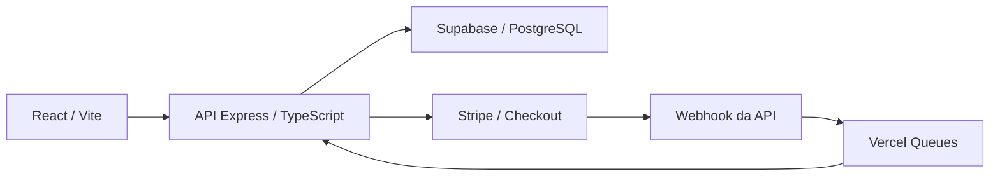

# Lerium Shop: caracterização

Lerium Shop vende produtos de tecnologia. O navegador React 19/Vite conversa com a API Express/TypeScript; o backend usa PostgreSQL no Supabase para catálogo, estoque, reservas e pedidos e Stripe para catálogo financeiro e Checkout hospedado. Vercel hospeda os projetos existentes e processa tarefas com Queues. O trabalho estuda sincronização administrativa de catálogo, sem recriar infraestrutura.

Em `stripe_to_supabase`, produtos/Price/metadata.stock do Stripe formam a origem e a RPC `sync_stripe_catalog_product` atualiza o destino atomicamente. Em `supabase_to_stripe`, catálogo e disponível do banco formam a origem e o serviço publica alterações do produto ou uma nova versão de Price. O vínculo usa o código Stripe, não o nome. Disponível é `on_hand - reserved`; copiar disponível 2 com reservado 4 produz físico 6, mantendo reservado 4.

Antes de escrever no destino, o serviço exige auditoria disponível. Importar produto existente é ignorado; ação completa atualiza detalhes, preço e estoque; ações seletivas preservam os demais atributos. Entradas inválidas não podem virar zero silenciosamente. O teste PGlite lê as definições SQL reais, cria banco em memória, limpa tabelas entre casos e fecha o banco após a suíte.

## Base e acessos observados em 15/10/2026

- Base: `main`, `09587fee4e6b5785d70df2823f112a10996b9382`; única alteração prévia era `arquivo.md` não rastreado.
- Origem: `https://github.com/weltergab/e-comerce.git`, privado; conta autenticada `weltergab` com permissão administrativa.
- Identidade Git existente: Gabriel Welter; não foram inventados autores ou reatribuídos commits.
- CI anterior: jobs backend/frontend, pull_request e push na main, Node 20, auditorias e check, sem upload de relatórios.
- Regras iniciais: main sem proteção, nenhum ruleset, exclusão automática de branches já desabilitada.
- Deploys Production frontend/backend apontam para o mesmo SHA da main, confirmados pela API de deployments do GitHub; branch experimental é distinta.
- CLI da Vercel sem autenticação válida; não houve alteração em projetos, variáveis ou deploys.
- URLs existentes: `https://storecy.vercel.app` e URLs específicas dos deployments registradas na evidência de conferência final.

Não se comprova integração com provedores reais, concorrência do Supabase, jornada no navegador, observabilidade em produção ou deploy condicionado ao CI somente com estes testes. O nome técnico histórico nos contratos internos permanece para compatibilidade.
