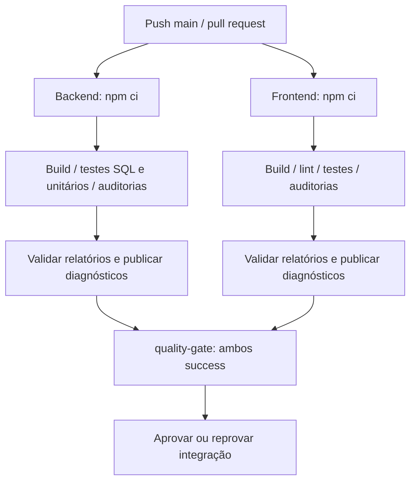

# Quality gates

Regra global: ambos os projetos precisam de todas as etapas obrigatórias aprovadas e upload de evidências bem-sucedido; só então `quality-gate` aprova. `failure`, `cancelled`, `skipped`, resultado ausente, rede indisponível e relatório ausente não equivalem a sucesso. Não há continue-on-error. Alertas ESLint são visíveis e discutidos; erros bloqueiam. Nenhuma exceção automática enfraquece os gates.

## G1 Build e validação

- Nome e critério: `npm run build` termina com exit code 0 em ambos os projetos, sem erro TypeScript/configuração.
- Justificativa: impedir código incompatível, frontend que não empacota ou configuração Vercel inválida.
- Momento: após npm ci, em cada pull request, push main ou execução manual suplementar.
- Evidência: build.log e build-step.json com comando, horários, duração, status e exit code.
- Consequência: falha do job e reprovação do agregador.
- Limitação/exceção: backend valida tipos e configuração, sem gerar bundle; build não prova operação remota nem pagamentos; sem dispensa automática.

## G2 Análise estática

- Nome e critério: ESLint frontend com zero erros/exit 0; tipos dos dois projetos também precisam passar em G1.
- Justificativa: bloquear defeitos e padrões rejeitados pelas regras existentes, sem instalar um linter backend por simetria.
- Momento: etapa lint após instalação, no mesmo evento de G1.
- Evidência: lint.log, configuração ESLint versionada e logs dos typechecks.
- Consequência: erro de lint/tipo reprova; avisos ficam visíveis e precisam ser discutidos.
- Limitação/exceção: análise estática não demonstra regra de negócio; não desabilitar regra para esconder erro.

## G3 Comportamento e evidência

- Nome e critério: todos os casos obrigatórios aprovados, zero falhas/ignorados/todo, suíte não vazia, todos os arquivos presentes, JUnit/JSON válidos e upload obrigatório concluído.
- Justificativa: R1–R7 abrangem comparação, entrada, idempotência, reservas, atomicidade, privilégios e auditoria.
- Momento: testes e validação de relatórios de ambos os projetos, após instalação.
- Evidência: tests.log, junit.xml, tests.json, manifest.json e artefato único por projeto/run/tentativa.
- Consequência: falha/ausência reprova job e quality-gate; falha de upload também impede aprovação.
- Limitação/exceção: PGlite cobre SQL isolado e mocks cobrem respostas simuladas; não comprovam navegador, concorrência real ou provedores remotos.

## G4 Dependências

- Nome e critério: zero vulnerabilidades altas/críticas em `npm audit --audit-level=high` e `npm audit --omit=dev --audit-level=high`, nos dois projetos.
- Justificativa: bloquear componentes com avisos conhecidos graves sem reduzir o limiar da política vigente.
- Momento: etapas audit-full e audit-production em cada execução obrigatória.
- Evidência: audit-full.json, audit-production.json, logs e exit codes no manifesto.
- Consequência: achado alto/crítico ou erro de consulta/rede reprova; achados abaixo do limiar continuam registrados.
- Limitação/exceção: auditoria é pontual e não prova ausência de vulnerabilidade desconhecida; novas exceções exigem escopo, mitigação, responsável, prazo e decisão de Gabriel.

Zero erros/falhas se justifica porque as verificações representam contratos executáveis já aceitos; tolerar uma falha desconhecida aceitaria regressão sem análise. Alto/crítico mantém a política prévia, em vez de inventar um percentual. Retenção de 90 dias apoia revisão acadêmica; uma seleção pequena fica no Git para sobreviver à expiração.

Diagnósticos e upload usam always(); o agregador também executa após falha dos jobs. A publicação dos relatórios integra o resultado dos jobs. Este fluxo é CI, não uma prova de bloqueio de deploy da Vercel. A proteção de merge precisa de configuração e evidência separadas.
